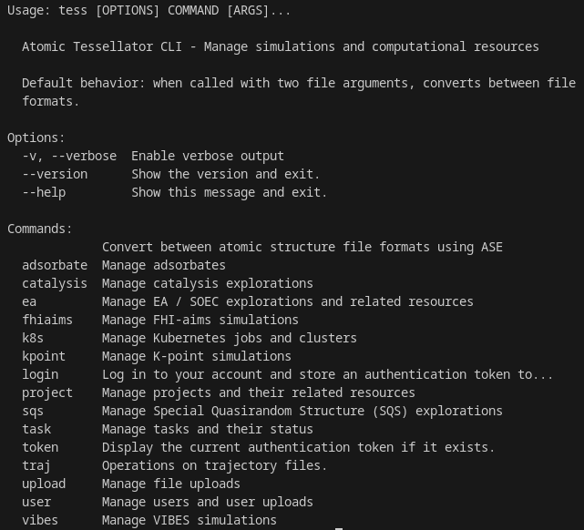
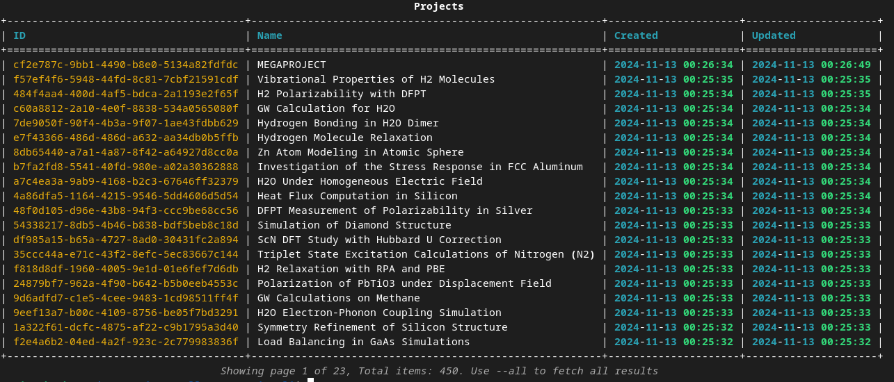
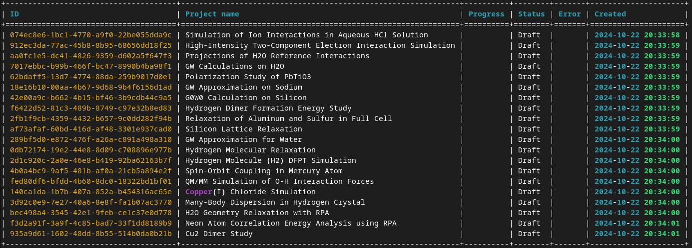
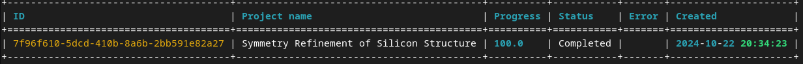

# Atomic Tessellator SDK and CLI (`atomict` / `tess`)

`atomict` is the Python client library used by Atomic Tessellator workers and
client programs to read platform records, publish artifacts and exchange atomic
structures. Its `tess` command lets users inspect projects and Tasks and operate
the available simulation/resource APIs. The SDK is not a simulation engine or a
standalone server. It communicates with `reality_server`; scientific executables
and their deployment belong to the consuming worker.

## Architecture

```mermaid
flowchart LR
  User[Operator] -->|CLI arguments| CLI[Click / Rich tess]
  Program[Python application or worker] -->|Python calls| SDK[atomict library / ASE / format helpers]
  CLI -->|HTTPX; HTTP or HTTPS; Token auth| API[reality_server REST API]
  SDK -->|Requests; HTTP or HTTPS; Token auth| API
  CLI -->|Read / write| CT[CLI token JSON]
  SDK -->|Explicit auth helper| LT[Library token JSON]
  SDK -->|Read / write| Files[Structures / trajectories / local workspace]
  SDK -->|Optional HTTP(S) log batches| Loki[Loki endpoint]
  subgraph Container[Existing consuming worker container, when used]
    Worker[Worker code] -->|Imports installed package| Installed[Same atomict SDK]
  end
  Installed -->|Authenticated platform API| API
```

The CLI and library have different credential-resolution paths, documented below.
No SDK process listens on a port. The optional worker-container boundary is owned
by the consumer; this repository supplies no container or hosted service.

## Repository tree with file descriptions

The inventory includes maintained source, tests, fixtures, images and CI files.
It excludes Git metadata, virtual environments, caches and generated distributions.
Screenshot assets show historical CLI output, not current acceptance evidence.

<details>
<summary>Complete maintained file inventory</summary>

```text
.flake8                                                   Flake8 configuration
.github/release-drafter.yml                               Release-note categories
.github/workflows/release-creator.yml                     Main-branch version tag, GitHub release, build and PyPI publishing workflow
.github/workflows/test-build.yml                          Pull-request distribution build; does not run the test suite
.gitignore                                                Local/build/cache exclusions
LICENSE                                                   MIT license
README.md                                                 SDK/CLI entry points, configuration, evidence and deployment handoff
atomict/__init__.py                                       Expose package version
atomict/__version__.py                                    Package version 1.2.28
atomict/api.py                                            Requests-based library HTTP helpers and retry policy
atomict/ase/atatoms.py                                    ASE wrapper and platform atomic-state synchronization
atomict/auth.py                                           Library authentication and token resolution
atomict/cli/__init__.py                                   Package marker
atomict/cli/commands/ai_assist.py                         AI-assistance command definitions; not registered by current tess entry point
atomict/cli/commands/common.py                            Shared Rich table rendering
atomict/cli/commands/convert.py                           convert CLI commands
atomict/cli/commands/exploration/__init__.py              Package marker
atomict/cli/commands/exploration/soec.py                  soec CLI commands
atomict/cli/commands/exploration/sqs.py                   sqs CLI commands
atomict/cli/commands/helpers.py                           Display formatting helpers
atomict/cli/commands/k8s.py                               k8s CLI commands
atomict/cli/commands/login.py                             login CLI commands
atomict/cli/commands/organization.py                      Organization command definitions; not registered by current tess entry point
atomict/cli/commands/project.py                           project CLI commands
atomict/cli/commands/simulation/fhiaims.py                fhiaims CLI commands
atomict/cli/commands/simulation/kpoint.py                 kpoint CLI commands
atomict/cli/commands/simulation/qe.py                     qe CLI commands
atomict/cli/commands/task.py                              task CLI commands
atomict/cli/commands/token.py                             token CLI commands
atomict/cli/commands/traj.py                              traj CLI commands
atomict/cli/commands/upload.py                            upload CLI commands
atomict/cli/commands/user.py                              user CLI commands
atomict/cli/commands/workspace.py                         workspace CLI commands
atomict/cli/core/client.py                                HTTPX CLI client, authentication and pagination
atomict/cli/core/config.py                                CLI environment credentials and saved token file
atomict/cli/core/utils.py                                 CLI pagination display utilities
atomict/cli/main.py                                       Click command registration, logging, completion and tess entry point
atomict/env.py                                            Platform-specific library credential store and legacy API-root validator
atomict/exceptions.py                                     SDK exception types
atomict/infra/README_LOKI_LOGGING.md                      Detailed optional Loki logging examples
atomict/infra/__init__.py                                 Package marker
atomict/infra/distwork/__init__.py                        Package marker
atomict/infra/distwork/environment.py                     Worker launch environment validation
atomict/infra/distwork/task.py                            Task status/progress API helpers
atomict/infra/logging.py                                  Console logging and optional queued Loki HTTP handler
atomict/io/__init__.py                                    Package marker
atomict/io/atoms.py                                       Atomic structure I/O helpers
atomict/io/cif.py                                         CIF parsing
atomict/io/fhiaims.py                                     FHI-aims output parsing
atomict/io/formats/__init__.py                            Package marker
atomict/io/formats/atraj.py                               AT trajectory format
atomict/io/formats/tess.py                                TESS trajectory serialization
atomict/io/formats/traj.py                                Trajectory format helpers
atomict/io/trajectory.py                                  Trajectory reading and writing
atomict/io/utils.py                                       File-size and I/O helpers
atomict/ml/__init__.py                                    Package marker
atomict/ml/model.py                                       Platform model lookup
atomict/project/__init__.py                               Package marker
atomict/project/link.py                                   link platform API helpers
atomict/project/note.py                                   note platform API helpers
atomict/project/project.py                                project platform API helpers
atomict/project/tags.py                                   tags platform API helpers
atomict/project/workbench.py                              workbench platform API helpers
atomict/reality/__init__.py                               Package marker
atomict/reality/oqmd.py                                   Bulk-material record lookup
atomict/reality/slabs.py                                  Slab record lookup
atomict/simulation/__init__.py                            Package marker
atomict/simulation/cantera.py                             cantera simulation API helpers
atomict/simulation/counterfactual.py                      counterfactual simulation API helpers
atomict/simulation/defect.py                              defect simulation API helpers
atomict/simulation/ea.py                                  ea simulation API helpers
atomict/simulation/fhi_aims.py                            fhi aims simulation API helpers
atomict/simulation/impact.py                              impact simulation API helpers
atomict/simulation/kpoint.py                              kpoint simulation API helpers
atomict/simulation/md.py                                  md simulation API helpers
atomict/simulation/mlrelax.py                             mlrelax simulation API helpers
atomict/simulation/models.py                              Simulation model helpers
atomict/simulation/qe.py                                  qe simulation API helpers
atomict/simulation/sh.py                                  sh simulation API helpers
atomict/simulation/sqs.py                                 sqs simulation API helpers
atomict/simulation/utils.py                               Source and relaxed geometry download/read helpers used by workers
atomict/user/__init__.py                                  Package marker
atomict/user/files.py                                     User upload/download API helpers
atomict/user/workspace.py                                 Workspace APIs and artifact downloads
atomict/utils/fhiaims/__init__.py                         Package marker
atomict/utils/fhiaims/geometry.py                         FHI-aims geometry conversion
atomict/utils/tenacity.py                                 Retry logging helpers
atomict/utils/traj.py                                     Trajectory utilities
img/at_adsorbate_get.png                                  Historical adsorbate listing screenshot
img/at_adsorbate_get_search.png                           Historical adsorbate search screenshot
img/at_project_get.png                                    Project listing screenshot
img/at_task_get.png                                       Task listing screenshot
img/at_task_get_completed.png                             Completed-task filter screenshot
img/tess.png                                              Historical CLI help screenshot
pyproject.toml                                            Setuptools metadata, tess entry point, development tools and package selection
requirements.txt                                          Runtime dependencies, including the exact pymatgen pin
tests/__init__.py                                         Package marker
tests/fixtures/Al.cif                                     Test fixture: Al.cif
tests/fixtures/Be.cif                                     Test fixture: Be.cif
tests/fixtures/cascade.atraj                              Test fixture: cascade.atraj
tests/fixtures/test.tess                                  Test fixture: test.tess
tests/integration/__init__.py                             Package marker
tests/integration/atomict/__init__.py                     Package marker
tests/integration/atomict/ase/__init__.py                 Package marker
tests/integration/atomict/ase/test_atatoms_integration.py Tests: atatoms integration
tests/integration/atomict/ase/test_trajectory_integration.py Tests: trajectory integration
tests/performance/tess.py                                 Performance exercise: tess
tests/performance/test_trajectory_perf.py                 Performance exercise: trajectory perf
tests/test_loki_handler_close.py                          Tests: loki handler close
tests/unit/__init__.py                                    Package marker
tests/unit/atomict/__init__.py                            Package marker
tests/unit/atomict/ase/__init__.py                        Package marker
tests/unit/atomict/ase/test_atatoms.py                    Tests: atatoms
tests/unit/atomict/cli/commands/test_convert.py           Tests: convert
tests/unit/atomict/cli/commands/test_login.py             Tests: login
tests/unit/atomict/cli/test_auth.py                       Tests: auth
tests/unit/atomict/io/test_tess.py                        Tests: tess
tests/unit/atomict/io/test_tess_bytes.py                  Tests: tess bytes
tests/unit/atomict/io/test_tess_v5.py                     Tests: tess v5
tests/unit/atomict/io/test_trajectory.py                  Tests: trajectory
tests/unit/atomict/parsers/assets/GaAs.cif                Test fixture: GaAs.cif
tests/unit/atomict/parsers/test_cif.py                    Tests: cif
tests/unit/atomict/simulation/test_utils.py               Tests: utils
tests/unit/atomict/utils/test_geometry.py                 Tests: geometry
```

</details>

## How to run locally

Python **3.10 or newer** is required by `pyproject.toml`; its classifiers list
3.10–3.13, which is metadata rather than a tested version matrix. This source
reports `atomict` **1.2.28**. Use an isolated environment with compatible wheels
for the compiled scientific dependencies; no GPU is needed for CLI help or record
listing. Memory and native-library requirements depend on structures and the
consuming application, with no fixed resource quota enforced by the SDK.

From a reviewed checkout:

```sh
python3 -m venv .venv
.venv/bin/python -m pip install .
.venv/bin/python -m pip check
.venv/bin/tess --version
.venv/bin/tess --help
```

Expected: consistent installed dependencies, version `1.2.28`, and a help listing
that includes `login`, `project` and `task`. See the branch validation section for
the environment and checks actually exercised. For local development, use
`.venv/bin/python -m pip install -e ".[dev]"`; the dev extra adds
pytest, Black, isort, mypy and Flake8. It does not establish that their checks pass.

For the published package or a Git checkout, the existing installation routes are:

```sh
python3 -m pip install atomict
python3 -m pip install 'git+https://github.com/AtomicTessellator/atomic_cli#egg=atomict'
# If installation tooling needs updating, do so in the selected environment:
python3 -m pip install --upgrade setuptools pip wheel
```

Those unpinned routes do not reproduce this dependency candidate. Select
a reviewed commit or an exact wheel hash for that purpose; see the dependency
section below. This repository has no lockfile establishing a complete resolved
environment and no automatic `.env` loader.

For authenticated use, explicitly select the intended API, then log in:

```sh
# Example only: use the existing, owner-verified tunnel; this command opens none.
export AT_SERVER=http://127.0.0.1:5004
.venv/bin/tess login
.venv/bin/tess project get
.venv/bin/tess task get --status completed
```

`login` prompts for username/password and saves a token; listing needs that saved
CLI token. Expected output is a table or a truthful empty listing for that user,
not a guaranteed canonical project or completed simulation. Choose the target
before login: the token store is not keyed by server origin. Use the existing
operator-approved endpoint and the consuming application's authorization rules.

Library programs import the modules they need. For example, this local metadata
read needs neither a server nor credentials:

```python
from atomict import __version__
print(__version__)
```

Actual platform methods in `atomict.api` accept `api_root`/`token` or use their
runtime environment fallbacks. They do not automatically invoke
`atomict.auth.resolve_token()`; applications requiring that helper must call it
explicitly. Keep library credentials separate from an assumption that CLI login
populates the same store on every OS.

## How to run on Docker

There is **no SDK Dockerfile, Compose service, image tag, exposed port or health
endpoint** in this repository. Running a standalone SDK container is not an
implemented deployment mode, so no SDK image build/run command is prescribed.
Install the selected package into a consuming application's image instead.

For Defect consumption, use the reviewed Omnibus checkout's
`defect/at-fhiaims.dockerfile` from its repository-root context and its worker
README. Select the SDK source or release explicitly in that build, resolve it
together with the worker requirements, and run `pip check`. Rebuild and qualify
the consumer image after selecting the updated SDK; an SDK metadata change does
not update an existing image or the Server's configured image binding.

A consuming image must inject each runtime variable itself; it does not inherit
another service's environment. Mount retained workspaces and provision credentials
at runtime. Do not bake tokens into wheels or images. Worker CPU/MPI/GPU, native
binaries, storage, architecture and lifecycle checks belong to that image. The
canonical Defect image uses Linux amd64 and private FHI-aims prerequisites; its
installed imports are narrower evidence than a successful scientific run.

## How to deploy to a dev VM

This is a library/one-shot CLI, not a daemon to deploy or restart. An authorized
operator can place a reviewed checkout or exact wheel on a VM with Python 3.10+,
create an isolated environment and use the local installation/help commands above.
Supply the intended `AT_SERVER` and authentication only for subsequent API calls.
The VM needs outbound HTTP(S) to that API and any requested artifact/log endpoint;
no SDK inbound port, ingress, database or server migration is needed.

In Jules's workspace, the access guide is
`/Users/jules/code/latent_space/seneschal_vm_testing/README.md`. Reuse the verified
user-owned transport; this README does not authorize opening/replacing tunnels,
restarting platform services or dispatching work. For worker consumption, follow
the selected Omnibus worker runbook and its server LaunchableJob/image binding,
not a separate SDK Kubernetes Deployment.

Retain the selected environment, credential-store location and application
workspace. Verify package version, wheel/source identity, `pip check` and required
imports in that environment; an API listing is an additional authenticated check.
CLI logs go to the terminal; `AT_DEBUG=enabled` also creates `atomict.log` in the
working directory. Consumer logging may use the optional Loki handler.

Ctrl+C stops an interactive CLI process, not a Task already launched remotely.
Use the owning platform's Task cancellation and termination readback for remote
work. Update/rollback by selecting a separately qualified environment or consumer
image; preserve original workspaces, receipts and failed attempts. The dependency
change was checked locally; no VM installation or platform operation was performed.

## Configuration and authentication

All application variables below are **runtime inputs** to the named Python
consumer, not Docker build arguments or Django admin overrides. No configuration
service injects them automatically. Supply them through the selected shell,
application process or worker's explicit launch environment. Secret values are
operator-supplied; examples deliberately contain no real credentials.

| Variable | Consumer / purpose | Requirement, type and default | Example / precedence |
| --- | --- | --- | --- |
| `AT_SERVER` | CLI `APIClient` and library `atomict.api`; platform API origin | Optional generally; default `https://api.atomictessellator.com`. Worker `environment_check()` requires a nonempty value. HTTP(S) URL; use no trailing slash for library path joining. | `http://127.0.0.1:5004`. CLI environment overrides constructor `base_url`; library truthy explicit `api_root` overrides environment. |
| `AT_TOKEN` | Library HTTP helpers and `auth.resolve_token()` | Optional token string; no default. Required for authenticated library requests unless a token is explicitly supplied or resolved by the caller. **Not read by the CLI token store.** | Provision privately; explicit truthy library token overrides environment. |
| `AT_USER` | Library auth fallback and CLI `Config` | Username string; no default. Required with `AT_PASS` only when the caller uses username/password authentication without a token. | `operator@example.invalid`. Library resolver prefers token/store; `tess login` explicitly prompts. |
| `AT_PASS` | Library auth fallback and CLI `Config` | Password string; no default; paired with `AT_USER` where applicable. | Secret injection, never a committed value. CLI examples use interactive login. |
| `AT_DEBUG` | CLI logging | Optional string; only exact `enabled` activates debug file + stream logging; default disabled. | `enabled`; otherwise `--verbose` affects stream log level. |
| `AT_PROJECT_ID` | `ATAtoms` synchronization project | ID string; no default; required if no truthy constructor `project_id` is supplied. | `11111111-1111-4111-8111-111111111111`. Constructor wins. |
| `AT_SIMULATION_ID` | `ATAtoms` synchronization simulation | ID string; no default; required if no truthy constructor `simulation_id` is supplied. | `22222222-2222-4222-8222-222222222222`. Constructor wins. |
| `AT_LOGGING_ENDPOINT` | `config_loggers()` optional Loki output | Optional origin/base URL string; no default. Unset/empty leaves console logging only. Handler appends `/loki/api/v1/push`. | `https://logs.example.invalid`. Applies only when that logging helper is called. |
| `AT_LOGGING_USERNAME` | `LokiHandler` HTTP Basic username | Optional string; no default. Used only with a nonempty logging password and no explicit `auth` tuple. | `worker-log-user`. Required only by the chosen endpoint's authentication policy. |
| `AT_LOGGING_PASSWORD` | `LokiHandler` HTTP Basic password | Optional secret string; no default; paired with logging username. | Inject privately; explicit `auth` tuple takes precedence. |
| `ATOMICT_API_ROOT` | Legacy `env.check_api_root()` validation only | Optional URL string; no default in the validator. If present, must start with `http` and have no trailing slash. **Does not select the HTTP clients' endpoint.** | `https://api.example.invalid`; configure real requests with `AT_SERVER` instead. |

Library `resolve_token()` uses a nonempty `AT_TOKEN`, then the library token JSON,
then `AT_USER`/`AT_PASS` authentication. Its store is
`~/Library/Application Support/atomict/config.json` on macOS,
`%APPDATA%/atomict/config.json` on Windows and `~/.config/atomict/config.json` on
other systems. The CLI always uses `~/.config/atomict/config.json`; `tess login`
writes that token and `tess token` prints it. Neither store binds a token to its
origin. The CLI's no-saved-token `get_client()` path calls an undefined `set_auth`
method in this source; use explicit `tess login` first rather than relying on
implicit environment-only CLI login. This pre-existing limitation is not changed
by the dependency repair.

These additional process/tool variables are distinct from platform settings:

| Variable | Actual use / default / requirement | Nonsecret example |
| --- | --- | --- |
| `HOME` | Standard home-directory resolution for CLI store and Unix library paths; use the real account home, not an application override. | OS-managed user home. |
| `APPDATA` | Required by library credential-path resolution on Windows; no library default. Does not relocate CLI `Path.home()` storage. | `C:\Users\operator\AppData\Roaming` |
| `SHELL` | Optional completion-shell detection; absent/unrecognized selects bash. Explicit `tess completion bash`, `zsh` or `fish` wins. | `/bin/zsh` |
| `PYTHONPATH` | Python interpreter import search path; CLI debug logging reports it. No SDK-specific default or requirement. | Usually unset in an installed environment. |
| `_TESS_COMPLETE` | Click shell-completion protocol generated by `tess completion`; absent means ordinary CLI execution. | `zsh_source`; not a server/runtime credential. |

The CI workflow uses its GitHub-provided token/permissions and OIDC trusted
publishing for release operations; those are not CLI configuration. No `.env`
example is supplied because this package does not load one. Logging examples are
in [the Loki guide](atomict/infra/README_LOKI_LOGGING.md); `config_loggers()` defaults
to batches of 10 / 2 seconds, while direct `LokiHandler` defaults are 100 / 5 seconds.
For deployed Task logs, follow the platform's log API/runbook.

## CLI usage

With the selected environment activated, `tess` displays the available commands.
Use `tess <command> --help` for subcommands and options. The maintained entry point
registers login/token, user/workspace, project/task, k8s/upload, convert/traj,
FHI-aims/k-point/QE and SQS/SOEC groups. Source files for organization and AI-assist
commands are present but are not registered by this entry point.

```sh
. .venv/bin/activate
tess
tess login
tess project get
tess task get
tess task get --status completed
tess completion
```

`login` prompts for credentials. `tess token` retains the existing token-inspection
command, but its output is the actual credential: do not include it in screenshots,
logs or support receipts. `tess completion` prints shell-specific setup instructions;
it does not install them automatically.

Historical command screenshots:






Library HTTP helpers retry selected connection/timeouts and HTTP 5xx failures,
including writes. They do not supply the canonical orchestrator's durable
uncertain-operation journal or an exactly-once dispatch guarantee. Follow the
owning workflow's reconciliation rules for effects; do not treat a failed local
call as proof that no server mutation occurred.

## Scientific dependency pin and Defect compatibility

`requirements.txt` now pins **`pymatgen==2025.10.7`** (previously 2025.3.10).
Setuptools reads this file into the wheel's `Requires-Dist` metadata. SDK Python
methods, the Python requirement and package version are unchanged.

**The target Defect-worker pairing is `doped==3.2.1`**, outside the SDK's runtime
requirements. This branch does not modify worker dependency selections.
Its versioned [metadata](https://pypi.org/pypi/doped/3.2.1/json)
requires `pymatgen>=2025.10.7`, so the previous SDK pin prevented a consistent
joint installation. The exact new pin selects the version exercised by the
compatibility assessment. Both releases declare Python >=3.10. Consumer locks
must still qualify the complete dependency set; this SDK has no environment lock.

The 31 October 2026 compatibility assessment used SDK staging commit
`86537f964f16bebd1ef181b4ce610b7c41a97cf9` with only the pymatgen requirement
changed. It found 79 passing selected SDK unit/ASE integration tests and no new
failing identities in the comparable Server/worker checks. Current-source Defect
vacancy generation passed in a retained Python 3.10.12 image containing
pymatgen 2025.10.7, doped 3.2.1 and ShakeNBreak 3.4.4. Fresh images and an
unrestricted pymatgen range were not qualified. The report and raw evidence are
in the workspace at
`/Users/jules/code/latent_space/lead-engineer_pymatgen_compatibility/REPORT.md`;
this local reference is not a public download.

The report also records an old pyzmq build failure in a fresh Python 3.12 Defect
environment, existing KPoint inherited-dependency issues and unchanged baseline
API failures. These remain consumer qualification work.

A 3 November exploratory installation with doped in the SDK also selected
`pymatgen-core==2026.7.31` through transitive dependencies. Its installed file
inventory overlapped pymatgen 2025.10.7 in 230 paths despite a passing `pip check`.
That mixed installation is not qualification of the pinned pymatgen code or a
Defect image. Before worker rollout, resolve and inspect its complete dependency
set, including distributions that share the `pymatgen` namespace. The final SDK
validation uses a separate, fresh environment without doped.

The checks below qualify this SDK source change. A package release, consumer
image rebuild and platform deployment remain separate steps.

### Validation of this branch

On 3 November 2026, a fresh macOS arm64 environment with Python **3.12.15**
installed this SDK in editable mode, its declared dependencies, pytest 8.4.2,
pytest-socket 0.8.1 and pip. No extra science-version constraints were supplied;
the environment selected NumPy 2.5.4, SciPy 1.18.1 and the declared spglib 2.5.0.

- `python -m pip check`: passed.
- SDK/CIF and pymatgen imports and a two-site Si structure smoke check: passed.
  Neither doped nor pymatgen-core was installed. All 450 hashed pymatgen package
  files matched their installed distribution records.
- Existing `tests/unit` and `tests/integration/atomict/ase`: **79 passed**,
  seven warnings, with sockets disabled and dummy project/simulation IDs.
- `tess --help` and `tess --version`: passed; version remains 1.2.28.
- Wheel and source distribution: built successfully; their dependency metadata
  contains `pymatgen==2025.10.7` and no doped requirement.

To reproduce the selected tests after installing the candidate in an isolated
environment:

```sh
.venv/bin/python -m pip install 'pytest>=8,<9' pytest-socket
AT_PROJECT_ID=00000000-0000-0000-0000-000000000001 \
AT_SIMULATION_ID=00000000-0000-0000-0000-000000000002 \
  .venv/bin/python -m pytest -q --disable-socket \
  tests/unit tests/integration/atomict/ase
```

Local command receipts, resolved package inventory, JUnit results and build
artifacts are under
`/Users/jules/code/latent_space/seneschal_pymatgen_doped/`; final SDK checks use
`sdk_*` filenames and `dist_sdk/`. The earlier mixed doped installation is retained
as exploratory evidence only. These checks do not qualify all supported Python
versions, Linux worker images, authenticated API operations or native science.

### Consumer rollout

1. Review the exact pin and select a new SDK release/version through the existing
   release process, or an explicitly reviewed source revision for testing.
2. Update each consuming Server/worker dependency selection and lock as applicable;
   retain its Python/NumPy/SciPy constraints and install the SDK plus consumer
   requirements together before running `python -m pip check`. Keep doped 3.2.1
   in the Defect worker and check namespace ownership as described above.
3. Build fresh consumer images and perform the remaining bounded native/ML and
   platform acceptance checks before changing deployed image bindings. The
   Defect-specific joint dependency workaround is separate follow-up work tracked
   in [Seneschal #81](https://github.com/AtomicTessellator/seneschal/issues/81).
4. Roll back through the previous qualified SDK/environment or consumer image.

## Infrastructure handoff for Michael

- **Artifact:** install a reviewed `atomict` wheel/source revision into the consuming
  environment; record SHA256 and resolved dependency inventory. This branch is a
  source candidate, not a published SDK successor.
- **Build/release:** `pyproject.toml` + `requirements.txt` define setuptools builds.
  `.github/workflows/test-build.yml` builds a wheel/sdist for selected main-targeted
  PRs; it does not run tests. `.github/workflows/release-creator.yml` tags the source
  version on main, creates a GitHub release and publishes through PyPI OIDC. Its
  main-branch/tag/version prerequisites must be resolved by the release owner;
  do not republish changed metadata under the existing 1.2.28 version.
- **Containers/GCP:** no SDK image, registry tag/digest, Cloud Build, Kubernetes
  manifests, Helm chart, namespace, ingress or probes exist here. Use the consumer's
  exact deployment files. For Defect: Omnibus `defect/at-fhiaims.dockerfile`, root
  build context and `defect/README.md`; provision its Server LaunchableJob separately.
  GCP IAM/service accounts and native-worker permissions belong to that deployment,
  not to a new SDK service.
- **Networking/authentication:** no listening ports; outbound HTTP(S) to the selected
  `reality_server`, downloaded artifact endpoints and optional Loki. Provide the
  applicable runtime variables above explicitly; preserve token-store ownership,
  server selection and the difference between CLI and library auth. Inject secrets
  only at runtime. No backend environment or admin setting is inherited automatically.
- **Resources/storage:** Python 3.10+, platform-compatible scientific dependencies;
  no SDK GPU requirement or promised memory cap. Preserve private token files,
  application workspaces and debug logs if enabled. Native engine licensing,
  MPI/GPU resources and scheduler limits remain worker responsibilities.
- **Checks/operations:** verify exact installation, dependency consistency and the
  consumer's required imports first; API, Task/artifact, termination and scientific
  checks are separate. See the branch validation section for the checks actually
  performed. Preserve existing user tunnels and evidence; rollback a consumer using
  its qualified previous environment/image rather than altering shared services or
  resetting Tasks.
